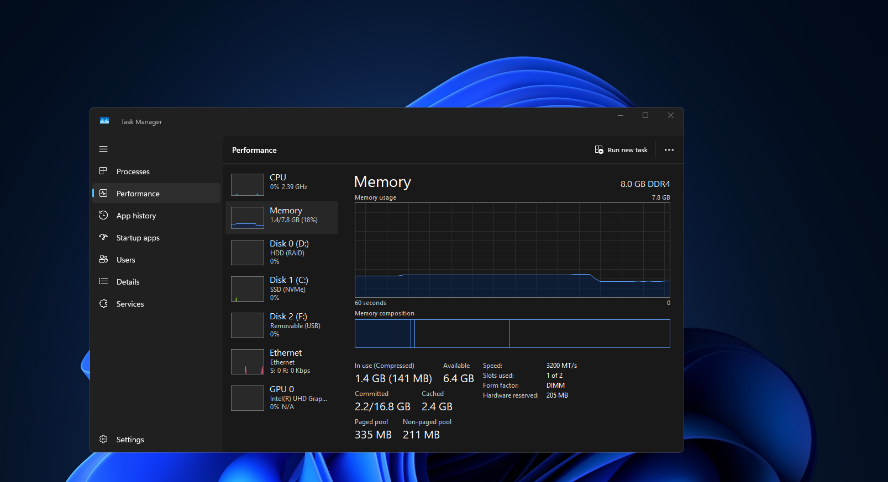

# ⚡ Windows RAM Optimizer — 1.6GB Idle RAM for 8GB PCs

> **4304MB → 1569MB** on Windows 11 26200 (8GB). ReviOS-grade, one-click, permanent.

[](https://www.npmjs.com/package/windows-ram-optimizer)
[](https://github.com/farhanic017/windows-ram-optimizer/releases)
[](LICENSE)
[](https://github.com/farhanic017/windows-ram-optimizer)
[](package.json)
[](https://github.com/farhanic017/windows-ram-optimizer/actions/workflows/ci.yml)
 <a href="https://www.patreon.com/farhanic0"></a>

**Tired of 3GB+ idle on 8GB?** This turns your 8GB Windows 11 into a ~1.6GB idle machine — game-ready, without breaking daily use. Live-tuned from a real 3.2GB leak (taskhostw 1.4GB, MemoryCompression off, ReviOS task broken 9/6) back to **1.56GB TaskMgr**.

[](https://github.com/farhanic017/windows-ram-optimizer)

> ### 🆕 v2 — pure-PowerShell edition (`ramfix.ps1`) — now the recommended path
> **No Node / npm / Python required** — one script, runs on any stock Windows 11.
> - 🎨 **Graphics-safe watchdog** — never trims DWM / shell / visible / foreground / GPU-active / critical-system processes, and **never purges standby memory while you drag** (single or multi-window) or when the GPU is in 3D → dragging stays smooth, no "graphic loss"
> - 🎮 **Genshin-ready** — `GenshinImpact`, `NZXT CAM` and `cam_helper` are force-trimmed every 2-minute cycle, page file pinned to 16GB (commit limit 14 → 24GB)
> - 📉 **`-Mode Reduce`** — deep process cut: svchost 50 → 27, session-0 66 → 40, OS baseline **~76 processes**
> - 🖥️ **NZXT CAM 50MB overlay** — starts with Windows, **opens no terminal window** (the stuck-`Windows-Terminal` bug is fixed), ~60–120MB resident
> - 🛡️ **Survives Windows Update** — self-heal re-applies anything an update resets and writes a `repair:` line to the log
> - 🐝 **Bluetooth untouched**, memory compression left ON, fully reversible (`-Mode Revert`)

---

## 🚀 Quick start — PowerShell edition (recommended)

Download or clone, open **PowerShell as Administrator** in the folder:

```powershell
Set-ExecutionPolicy -Scope Process Bypass -Force
.\ramfix.ps1 -Mode Apply        # base profile (UAC prompt)
.\ramfix.ps1 -Mode Reduce       # deep process reduction -> ~76 procs + self-heal armed
.\ramfix.ps1 -Mode CamSetup     # optional: NZXT CAM 50MB overlay (only if you use CAM)
```

### Modes

| Mode | What it does |
|---|---|
| `-Mode Apply` | Base profile: memory compression ON, RAM watchdog task, Defender exclusion, HKLM Run, fixed 16GB page file on `C:` |
| `-Mode Reduce` | Deep cut: ~15 services → Disabled, ~25 → Manual, per-user templates demand-start, Edge/OneDrive/Widgets autostart removed, svchost split threshold 16MB, writes `targets.json` and arms self-heal |
| `-Mode CamSetup` | NZXT CAM → overlay-only: mini HUD on startup, hardware acceleration off, `CAMService` Automatic, logon starts the exe **directly** (no console), silent desktop shortcut |
| `-Mode Status` | Live RAM / MMAgent / scheduled tasks / watchdog log |
| `-Mode PurgeNow` | One purge right now (drag guard bypassed on purpose) |
| `-Mode Repair` | Run the self-heal sweep now (it also runs automatically once per boot) |
| `-Mode Revert` | Undo everything: services, telemetry, task, exclusions, page file, CAM settings, autostart entries |
| `-Mode Apply -Aggressive` | Also cuts Spooler / BT / Maps etc. — **not recommended** (Bluetooth is kept by default) |

### Verify

```powershell
.\ramfix.ps1 -Mode Status      # RAM, MMAgent, task state, watchdog log tail
Get-Content C:\ProgramData\ReviOS\watchdog.log -Tail 20
```

Log lines you should see every 2 minutes:

```
2026-10-12 15:38:12  game-trim cam_helper(9188) 11MB; NZXT CAM(6384) 58MB; ...
2026-10-12 15:38:14  trim=26 kept=45 PURGED status=0x00000000 free=5240MB admin=True
2026-10-12 16:00:13  repair: PageCombining on        # self-heal fixed something an update reset
```

---

## 🛡️ Why dragging never loses graphics

The stock `EmptyStandby.ps1` trims **every** process and purges standby memory blindly — that is exactly what makes dragging a window (or several) stutter and "lose graphics" on an iGPU that shares system RAM. The v2 watchdog (`ps/EmptyStandby.ps1`) adds guards on every 2-minute cycle:

- **Never trimmed:** `dwm.exe`, `csrss.exe`, `explorer.exe`, `sihost.exe`, `ShellExperienceHost`, `SearchUI`, the foreground process, any process with a visible window, any process using the GPU, and critical system processes
- **Only trimmed:** processes that are CPU-idle right now (`GetProcessIoCounters` deltas)
- **Purge skipped when:** a mouse button is down (drag in progress), the cursor moved in the last ~1.3s, or a 3D/video GPU workload is running
- The purge uses the correct privilege (`SeProfileSingleProcessPrivilege`) instead of failing silently with `0xC0000022`

`DragFullWindows` stays at `1` — Aero drag is never disabled.

## 🛡️ Survives Windows Update

Windows Update (and app updaters) quietly reset service start modes, re-add startup entries, flip MMAgent off and can drop scheduled tasks. v2 writes the desired state to `C:\ProgramData\ReviOS\targets.json` and re-applies it:

- **`ReviOS-LogonRepair`** — `SYSTEM` scheduled task at every logon (session 0, never shows a window)
- **the watchdog** — calls the repair in-process on its first cycle after each boot, so even a broken/missing logon task gets fixed
- Each task re-registers the other if an update removes one
- Every repair is logged: look for `repair:` lines in `watchdog.log`
- `-Mode Repair` runs the sweep immediately

Repairs cover: service start modes, per-user service templates, policy keys (Widgets, telemetry, activity feed), svchost split threshold, page file size, memory compression, Defender exclusion, HKLM Run entry, and Edge/OneDrive/NZXT autostart cleanup.

## 🖥️ NZXT CAM — 50MB overlay that starts with Windows

`-Mode CamSetup` (run once after installing NZXT CAM):

- Settings: `miniModeOnStartup`, `startMinimized`, `startCAMMinimized`, `disableHardwareAcceleration` (snapshots backed up, fully revertible)
- Logon entry runs `"C:\Program Files\NZXT CAM\NZXT CAM.exe" --disable-gpu --disable-hardware-acceleration --in-process-gpu --startup` — **no console process at all**
- `CAMService` stays Automatic so sensors are up before the HUD
- The watchdog force-trims CAM every cycle → **~60–120MB resident** with a 318×67 HUD, vs the full app
- Desktop shortcut `CAM Overlay 50MB.lnk` starts it silently

> **Bug fixed in v2:** the old logon entry started `powershell.exe`, CAM inherited that console and `cam_helper` kept it alive — so a `Windows Terminal` window sat open at every logon forever. Also `-WindowStyle Hidden` is ignored because Windows Terminal is the default terminal; the shortcut now goes through a hidden `wscript` launcher, and `CAM-Overlay.ps1` starts CAM with `CreateNoWindow`.

## 📉 What `-Mode Reduce` cuts

| Action | Effect |
|---|---|
| ~15 services → **Disabled** | diagnostics/telemetry/discovery: `DPS`, `PcaSvc`, `DoSvc`, `DusmSvc`, `lfsvc`, `SensorService`, `SSDPSRV`, `NcbService`, `TrkWks`, `iphlpsvc`, `lmhosts`, ... |
| ~25 services → **Manual** | `Spooler`, `ClickToRunSvc`, `WSearch`, Intel/Realtek helpers, `LanmanServer`, `wlidsvc`, `TokenBroker`, `ClipSVC`, ... |
| Per-user templates → demand-start (Start=3) | `WpnUserService`, `CDPUserSvc`, `NPSMSvc`, `CloudBackupRestoreSvc` |
| Startup cleanup | Edge / OneDrive autostart removed, Widgets policy off, per-user `.lnk.bak` boot popups moved to `C:\ProgramData\ReviOS\StartupBackup` |
| svchost grouping | `SvcHostSplitThresholdInKB = 16777216` → svchost 50 → 27 processes |

Bluetooth services (`bthserv`, `BTAGService`, `BthAvctpSvc`) are **not** touched — Bluetooth keeps working.

## ♻️ Revert

```powershell
.\ramfix.ps1 -Mode Revert     # PowerShell edition: everything back (services, telemetry,
                              # task, exclusions, page file, CAM settings, autostart)
```

Node edition: `ramfix --revert`.

---

## 📦 Node / npx / Python editions (v1 — still supported)

The original one-click app. Recommended only if you already have Node/Python; the PowerShell edition above does the same job with more safety and zero dependencies.

### GUI App
```bash
npx windows-ram-optimizer --gui
# or
npm i -g windows-ram-optimizer
ramfix --gui        # same as win-ram-optimizer
```
Opens `http://localhost:8787` → **Fix now — 1.6GB idle (admin)**. Run GUI/terminal as **Administrator** (right-click → Run as admin).

### CLI
```bash
ramfix                 # safe profile
ramfix --aggressive    # also Manual Spooler/BT/Maps
ramfix --status        # RAM / MMA / task
ramfix --revert        # restore WSearch/SysMain
```

### Python (Tkinter)
```bash
python python/optimizer.py --gui
python python/optimizer.py
```

### 📊 What the v1 editions do

| Area | Action | Saved |
|---|---|---|
| **RAM watchdog** | `C:\ProgramData\ReviOS\EmptyStandby.ps1` Boot + every 2min indefinite (`ReviOS-EmptyStandby` task) — `EmptyWorkingSet` + `NtSetSystemInformation 80` + `GC` | **~1.2GB** |
| **Memory compression** | `Enable-MMAgent -MemoryCompression/-PageCombining` + `HKLM\Run ReviOS_FixMMAgent` | **~700MB** |
| **Services** | `DSAService/DSAUpdateService/WSearch/CAMService/postgresql-x64-18 → Manual`, `AsusUpdateCheck → Disabled` | **~400MB** |
| **Telemetry** | `DiagTrack/dmwappushservice Disabled`, `AllowTelemetry 0`, `EnableActivityFeed 0` | privacy |
| **CAM 50MB** | Kill `NZXT CAM.exe` UI, keep `CAMService` (10MB) + `cam_helper`; `CAM-Overlay.ps1 --disable-gpu` + trim; block `HKCU Run NZXT.CAM` | **650→50MB** |
| **Pools** | `SystemCacheLimit 1GB`, Defender exclusion | stability |

## 🗂️ Layout (PowerShell edition)

| File | Role |
|---|---|
| `ramfix.ps1` | Entry point — all modes, UAC elevation, baselines + revert |
| `ps/EmptyStandby.ps1` | Guarded watchdog (trim + purge + drag guard + game-trim + self-heal call) |
| `ps/Repair.ps1` | Self-heal from `targets.json` (runs at logon as SYSTEM + once per boot) |
| `ps/CAM-Overlay.ps1` | Overlay-only CAM launcher (starts CAM detached from any console) |
| `ps/FixMMAgent.ps1` | Keep memory compression + page combining on after boot |
| `tools/probe-purge.ps1` | Diagnostics: verify the purge privilege and `NtSetSystemInformation` result |

Everything deploys to `C:\ProgramData\ReviOS` (with a Defender exclusion) so it survives reboot and Disk Cleanup.

## 🏷️ Tags

`windows11` `ram` `memory` `optimizer` `debloat` `revios` `idle-ram` `memory-compression` `watchdog` `telemetry-removal` `privacy` `performance` `gaming-optimization` `nzxt-cam` `8gb-ram` `low-ram` `windows-optimization` `powershell`

## 👤 Author

**Farhan Dhrubo** — [@farhanic017](https://github.com/farhanic017)

Copyright (c) 2026 Farhan Dhrubo (GPL-3.0-or-later). Live-tuned on 8GB Win11 Education 26200/26300.

## 🤝 Contribute

`npm install && npm test` — PRs welcome! `npx windows-ram-optimizer --status` or `.\ramfix.ps1 -Mode Status` to debug.

## ⭐ Star to trend

If this saved your RAM, **star ⭐ + share** — helps 8GB users find it fast.

---

> *v1 tested 2026-09-07: `taskhostw 1441MB` leak killed, `Standby 3.3GB` purged, `MMA True` → `4148MB→1569MB`.*
> *v2 tested 2026-10-12 (8GB, i5-11400 + UHD 730, Win11 26300): Apply `6080→~3000MB`, Reduce → svchost 50→27 / session-0 66→40 / ~76 procs, page file 16GB (commit 14→24GB), CAM overlay 7 procs ~60–120MB with no terminal window, drag-guard verified live, self-heal repaired post-update drift.*
